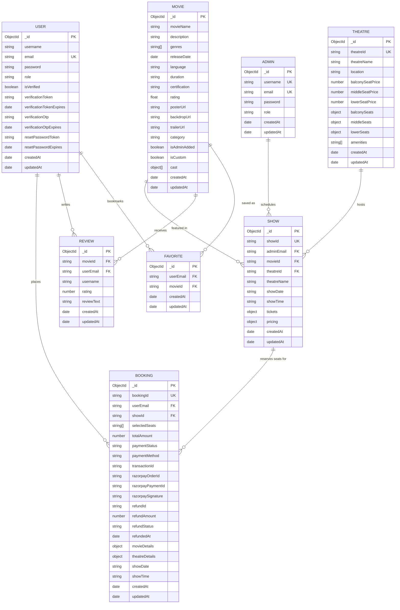

# Entity-Relationship (ER) Diagram

This document defines the data schema relationships of the iMovies cinema ticketing platform. The database uses MongoDB with Mongoose ODM to model entities, reference keys, and nested structures.



---

## Schema Highlights

### 1. Embedded Real-Time Ticket Grid (`Show.tickets`)
Unlike relational systems that store every seat as an individual database row, each `Show` record stores a fast indexed dictionary of seats:
- **Key Pattern**: `seatId` (e.g., `B-A1`, `M-C4`, `L-G10`).
- **Seat Document**:
  ```json
  {
    "seatId": "B-A1",
    "seatNumber": "B-A1",
    "row": "A",
    "col": 1,
    "tier": "balcony",
    "tierLabel": "Balcony (VIP)",
    "price": 350,
    "status": "available",
    "lockedBy": null,
    "lockExpiresAt": null,
    "bookingId": null
  }
  ```
- **Concurrency & Locking**: When a customer selects seats, the status switches to `locked` with a 10-minute TTL timestamp (`lockExpiresAt`). Background cron jobs automatically revert stale holds back to `available`.

### 2. Snapshot Integrity in Bookings
To protect financial and audit history against future catalogue edits:
- Each `Booking` stores immutable snapshot objects of `movieDetails` (name, poster, duration) and `theatreDetails` (theatre name, physical address) at the time of purchase.
- Razorpay order ID, payment ID, and cryptographic HMAC signatures are stored directly on the booking document for verification and instant refund processing.
