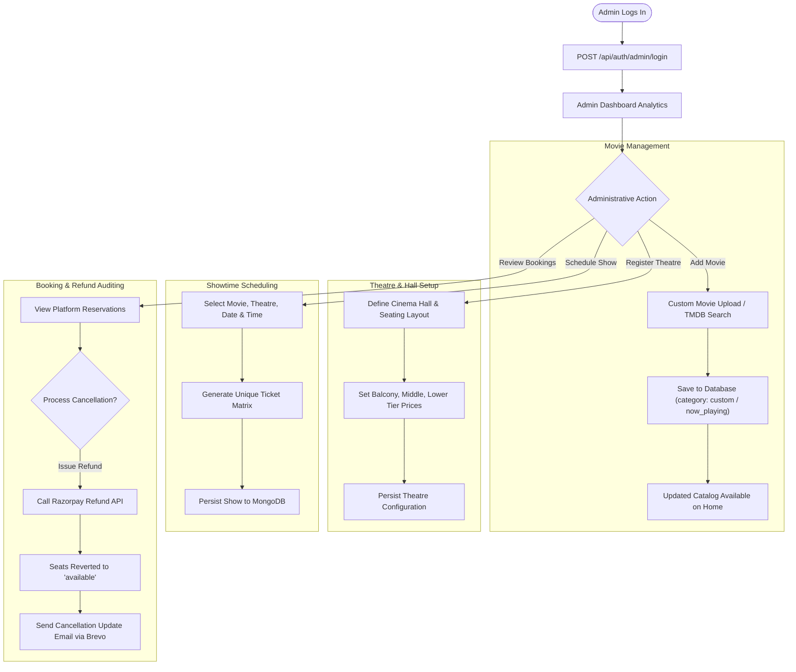

# User Flow Diagrams

This document illustrates the end-to-end operational workflows in the iMovies ticketing ecosystem:
1. Customer Booking Journey (from discovery to confirmed digital ticket pass).
2. Administrator Management Lifecycle (theatre, movie, showtime, and refund handling).

---

## 1. Customer Booking Journey

```mermaid
flowchart TD
    Start(["Visitor Opens iMovies"]) --> Landing{"User Authentication State"}
    
    Landing -->|"Guest Visitor"| LandingPage["Landing Page / Showcase"]
    LandingPage --> AuthModal["Sign In / Register / Verify Email"]
    AuthModal --> Home["Home Catalog View"]
    
    Landing -->|"Authenticated"| Home
    
    subgraph CatalogDiscovery["1. Movie Discovery"]
        Home --> CatalogTabs{"Catalog Filter"}
        CatalogTabs -->|"Now in Theatres"| ActiveMovies["Currently Screening Movies"]
        CatalogTabs -->|"Upcoming Releases"| FutureMovies["Upcoming Movies & Release Dates"]
        ActiveMovies --> MovieDetail["Movie Overview & Details"]
        FutureMovies --> MovieDetail
        MovieDetail --> AmbientTrailer["Ambient Trailer Player & Cast Profiles"]
    end
    
    subgraph ShowSelection["2. Theatre & Showtime Selection"]
        MovieDetail --> BookCTA["Click 'Book Tickets'"]
        BookCTA --> ShowtimePicker["Select Screening Date & Time Slot"]
        ShowtimePicker --> PastCheck{"Is Showtime Past?"}
        PastCheck -->|"Yes"| ShowDisabled["Booking Disabled Banner"]
        PastCheck -->|"No"| SeatMap["Enter Interactive Seating Map"]
    end
    
    subgraph LiveSeating["3. Real-Time Seat Selection & Lock"]
        SeatMap --> SocketConnect["Join WebSocket Room: show_showId"]
        SocketConnect --> ViewSeats["Display Tiers: Balcony, Middle, Lower"]
        ViewSeats --> SelectSeat["User Clicks Available Seats"]
        SelectSeat --> SeatValidation{"Max 8 Seats & Not Held?"}
        SeatValidation -->|"Conflict"| SeatAlert["Notify Seat Unavailable"]
        SeatValidation -->|"Valid"| UpdateSelection["Highlight Seat & Update Subtotal"]
        UpdateSelection --> LockSeatsBtn["Click 'Lock Seats & Proceed'"]
        LockSeatsBtn --> PostLock["POST /api/bookings/lock"]
        PostLock --> TTLTimer["10-Minute Hold Timer Starts"]
        PostLock --> SocketBroadcast["Broadcast 'seatsUpdated' to all viewers"]
    end
    
    subgraph PaymentCheckout["4. Secure Payment Gateway"]
        TTLTimer --> PaymentModal["Open Payment Modal"]
        PaymentModal --> SelectMethod["Select Payment Method (UPI, Cards, NetBanking)"]
        SelectMethod --> PayOrder["POST /api/payment/create-order"]
        PayOrder --> RazorpayGateway["Open Razorpay Checkout Gateway"]
        RazorpayGateway --> PayAction{"Payment Outcome"}
        PayAction -->|"Dismiss / Expire"| ReleaseHold["Seats Released to Public"]
        PayAction -->|"Success"| VerifySig["POST /api/payment/verify"]
    end
    
    subgraph TicketIssuance["5. Booking Confirmation & Digital Ticket"]
        VerifySig --> Confetti["Trigger Confirmation & Confetti Animation"]
        VerifySig --> EmailDispatch["Brevo Service: Send Email with QR Code"]
        VerifySig --> TicketModal["Display Digital Ticket Pass Modal"]
        TicketModal --> PrintAction["Download / Print PDF Ticket Pass"]
        TicketModal --> MyBookings["Saved to User 'My Bookings' Dashboard"]
    end
```

---

## 2. Administrator Management Workflow

